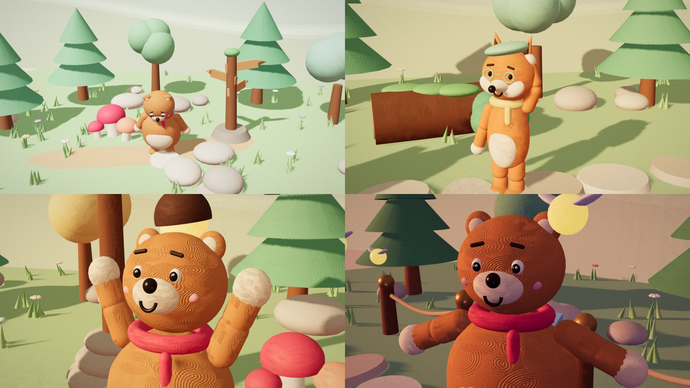
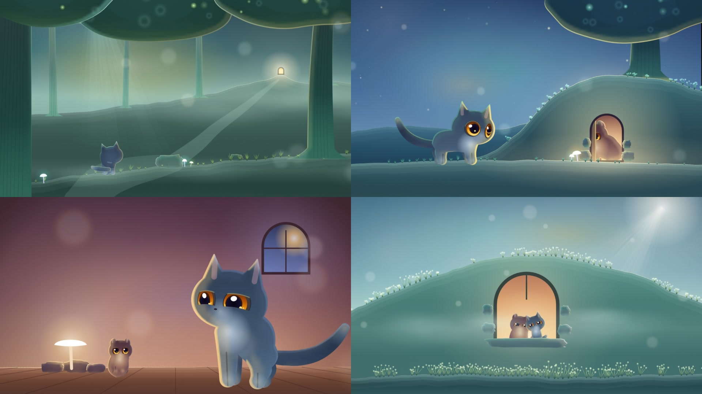
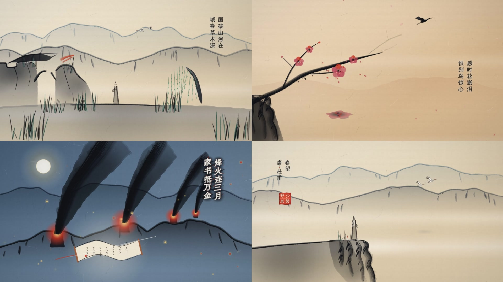
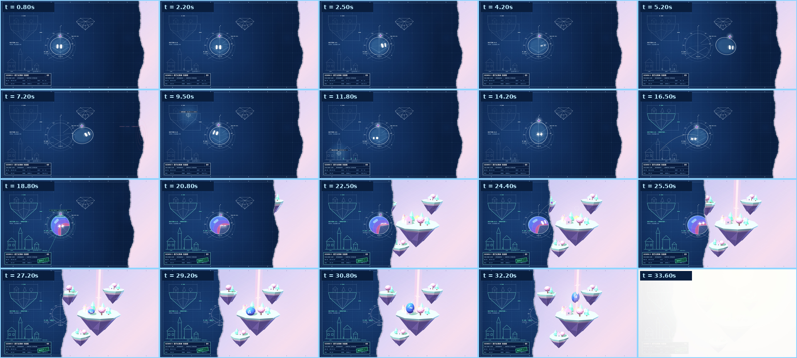

# StarDino StyleHop · HTML-in-Canvas × Three.js × WebGL2 多场景风格工作台

> **一风格一多场景样片（Multi-Scene Style Showreel）× 浏览器原生富排版（HTML-in-Canvas）× Three.js 三维舞台 × WebGL2 实时光学合成。**  
> 工具链与工程流程标准化，场景内容随风格媒介专有化定制。  
> Created by **Star Dinosaur (星星恐龙)** · MIT



| `twilight-fable` · 微光绘本寓言（夜湖寻星录） | `ink-wash` · 宣纸水墨诗卷（杜甫《春望》） |
| :--: | :--: |
|  |  |

---

## 核心架构与工具链特性

`StyleHop` 基于 Blink 原生特性 **`HTML-in-Canvas` (`CanvasDrawElement`)** 与 **Three.js / WebGL2** 构建了一套从多场景编排、3D 舞台合成、程序化质感/声学生成、交互调参到自动化门禁的完整工程体系：

| 核心模块 | 工程能力说明 |
| :-- | :-- |
| **多场景时间轴与去固化内容架构 (`[data-scene]`)** | 每个风格（`styles/<id>/`）由 3–5 个分镜组成。框架只提供标准化时间轴与合成工具链，**不绑定任何固定内容模板**——动画类风格可全屏运行多机位 3D/2D 镜头演出，版式类风格可编排图文海报，手稿类风格可推演图解。 |
| **Three.js 3D 世界与 HTML-in-Canvas 混合舞台 (`engine/stage.js` + `three_bridge.js`)** | 内置离线 `engine/vendor/three.min.js`，支持在 `styles/<id>/world.js` 中用参数化代码构建 3D 场景、软体/刚体物理与相机运镜，并与 `<canvas content="drawable" layoutsubtree>` 的透明 DOM 图层、独立 3D 浮层（`[data-layer] drawable`）或 3D 表面活体贴图（`createDomTexture`）零延迟同台合成。 |
| **可组合 WebGL2 材质与光学 Pass 链 (`engine/passes/`)** | 内置 `lens`（斯涅尔色散透镜）、`clay`（软陶指纹浮雕与移轴景深）、`riso`（孔版双滚筒网点）、`spotlight`（双锥聚光灯）、`inkbleed`（宣纸毛细洇墨）、`crt`（阴极射线荧光）、`grain`（表面肌理与暗角）等可插拔着色器。 |
| **DOM 原生自动化体检门禁 (`tools/audit.mjs`)** | 在无头 Chrome 157+ 中默认同时遍历 16:9 与 9:16 双画幅下的全部场景，自动拦截运行时报错、文字越界/裁切、过小字号（`<12px`）、文案停留时长不足与浮层恶意遮挡。 |
| **交互式 Studio 调试工作台 (`gallery/`)** | 支持分镜单跳/循环锁定、逐帧时间轴 Scrubbing、声学事件轨预览、DOM 版面体检框实时叠加（Audit Overlay）、画布原位点击改字（`contenteditable`）与 Shader Uniform 滑杆调参。 |
| **程序化物理贴图与画面驱动声学 (`tools/textures.py` + `tools/sound.py`)** | `textures.py` 生成宣纸纤维、软陶拇指指纹、半调网屏、拉丝金属、晒图折痕等 512×512 无缝贴图（`u_paper`）；`motion.js` 自动提取 `window.CUES` 时间码，驱动 `sound.py` 合成 48kHz 立体声拟音，由 `render.mjs` 归一至 `-15 LUFS` 母带。 |
| **可选人声轨 (`tools/voice.py` + `tools/sound.py --voice`)** | 按成品 `voice.json` 的场景锚点生成 48kHz 人声、时间码与 SRT；edge-tts / Kokoro / 任意 `VOICE_CMD` 后端；`render.mjs --voice` 自动生成并混音，带 sidechain ducking 与 `--no-voice` 回退。TTS 是构建步骤，不进入逐帧渲染，默认关闭。 |

---

## 快速开始

```bash
npm install                      # 仅依赖 playwright-core
# 需要 Chrome 157+（Chrome 151–154 为 legacy 兼容路径）；可通过 CHROME_BIN 或 PLAYWRIGHT_CHROME 指定可执行文件路径

# 1. 启动 StyleHop Studio 交互式调试工作台
npm run serve                    # 打开 http://127.0.0.1:8080/gallery/
                                 # Chrome 157+ 无需启动参数；151–154 请附带 --enable-blink-features=CanvasDrawElement

# 2. 执行自动化体检门禁（默认同时检验 16:9 与 9:16 双画幅）
node tools/audit.mjs --style <style-id>

# 3. 确定性并发渲染：生成 2x2 多场景检视表与带 -15 LUFS 音效的 MP4 母带
node tools/render.mjs --style <style-id> --sheet styles/<style-id>/contact_sheet.jpg
node tools/render.mjs --style <style-id> --video <work-dir>/<style-id>/<product-slug>-v1/<product-slug>.mp4 --fps 30

# 4. 可选人声：先生成 voice.wav + voice.timing.json + voice.srt，再随视频混音
#    默认不启用人声；示例 manifest 见 tools/voice.example.json，后端与授权见下文
node tools/render.mjs --style <style-id> --video <work-dir>/.../<product-slug>.mp4 \
  --voice ../out/stardino-stylehop-test/<style-id>/<product-slug>-v1/voice.json

# 5. 素材管线：生成无缝物理质感贴图 / 合成声学音轨
python3 tools/textures.py
python3 tools/sound.py --preset glass --out <work-dir>/demo.wav
```

在不支持 HTML-in-Canvas 的普通浏览器中，舞台会自动优雅降级为 DOM + 3D/Canvas 视图，页面不会白屏。

---

## 可选人声（Voice）

人声默认关闭，只有传 `--voice` 才启用。TTS 是构建步骤：先生成 `voice.wav`、`voice.timing.json`、`voice.srt`，渲染期只做混音，不在逐帧 worker 里联网。

### Manifest

成品目录下的 `voice.json` 用场景锚定，字段兼容 lemo-opuscar 的 `lines.json`：

```json
{
  "provider": "edge",
  "voice": "zh-CN-XiaoxiaoNeural",
  "lines": [
    {
      "id": "l1",
      "text": "一滴墨，落进整个春天。",
      "say": "一滴墨，落进整个春天。",
      "subtitle": "一滴墨，落进整个春天。",
      "scene": 0,
      "offset": 0.45,
      "maxDur": 3.0
    }
  ]
}
```

- `scene` 可写分镜序号或 id；`anchor: "scene:0"` 等价；`at` 是绝对秒，优先于场景锚点。
- `offset` 相对场景起点，默认 `0.4s`；`maxDur` 超时直接报错，不拉伸音频——改 `rate` / `speed` 或缩短文案。
- `say` 是实际朗读文本（数字、缩写写全），`subtitle` 是字幕；`subtitle: false` 只发声、不出字幕。
- 未锚定的行按 `gap`（默认 `0.3s`）接在上一行之后；不允许重叠或越过场景切点。
- 14–16s 片长建议 1–2 句；中文单句 3s 约 10–14 字。

### 后端

| `provider` | 实现 | 适用（按台词 `profile` 语体区分，不与画风死绑） |
| :-- | :-- | :-- |
| `indextts2` | IndexTeam/IndexTTS-2（本地零样本音色+情感解耦大模型） | **古诗词吟诵（`profile: "recite"`，挂载 `emoAudio` 吟诵韵律）** 或 **有温度的故事/人文独白（`profile: "story"`，仅用纯声纹自然讲述，不带古诗拖腔）** |
| `kokoro-zh` | hexgrad/Kokoro-82M-v1.1-zh（本地 PyTorch，Apache-2.0） | **知识讲解/科普解说/清爽旁白（`profile: "narrator"`，含水墨风讲解事情）离线商用首选**（`zf_001` / `zm_010` / `zm_scholar`） |
| `f5` | SWivid/F5-TTS（本地流匹配零样本克隆） | 零样本音色克隆备选（研究/非商用来源音频） |
| `edge` | edge-tts（微软 Edge 在线语音） | 在线草稿/现代旁白兜底（保持 `pitch: "+0Hz"`，避免服务端变调产生电音） |
| `kokoro` | kokoro-onnx + 本地 ONNX 模型 | 英文成品、完全离线 |
| `command` | `VOICE_CMD` 命令模板 | CosyVoice2 / GPT-SoVITS / 其他自托管 TTS |
| `auto` | `recite` 自动选 `indextts2`，`narrator` 优先选 `kokoro-zh` | 快速开始 |

```bash
# edge-tts（当前机器已装）
python3 tools/voice.py build --script voice.json --cues cues.json --out-dir out/voice

# Kokoro：先装可选依赖，再把 kokoro-v1.0.onnx / voices-v1.0.bin 放进 tools/voice/
python3 -m pip install -r requirements-voice.txt
# 或独立 venv（Kokoro 需要 Python 3.11–3.13）
uv venv --python 3.12 .venv-voice
uv pip install --python .venv-voice/bin/python -r requirements-voice.txt

# 任意命令行 TTS（占位符：{text} {text_file} {out} {voice} {rate} {pitch} {lang}）
export VOICE_CMD='cosyvoice --text {text_file} --out {out} --voice {voice}'
python3 tools/voice.py build --script voice.json --provider command --cues cues.json --out-dir out/voice
```

### 渲染

```bash
# cues.json 可手写 {dur, scenes}，或由 render.mjs 自动生成；SRT 默认写到 <video>.srt
node tools/render.mjs --style <id> --video film.mp4 --voice voice.json \
  [--duck-db -10] [--voice-gain 0] [--srt film.srt]
```

`render.mjs --voice` 会在渲染帧之前生成/复用缓存，然后 `sound.py --voice` 做 sidechain ducking（默认讲话段音乐压 10 dB，attack 20ms / release 250ms），最后由 FFmpeg 统一 `loudnorm` 到 -15 LUFS / TP -1.2。不传 `--voice` 或传 `--no-voice` 的行为与旧版一致。

示例 manifest：[`tools/voice.example.json`](tools/voice.example.json)。授权：Kokoro-82M 为 Apache-2.0；edge-tts 工具是 LGPLv3，但使用的是微软 Edge 在线服务，商用前自行确认条款；ChatTTS / F5-TTS 等 CC-BY-NC 权重不要用于变现成品。模型权重与生成音频不进仓库，缓存放在 manifest 旁的 `.cache/voice/`。

---

## 仓库目录结构

```text
engine/            核心引擎：
                   - html_in_canvas.js（Chrome 157+ / 151–154 HTML-in-Canvas 兼容层：drawable、纹理上传、几何同步）
                   - stage.js（3D/Canvas 世界基底 + 多场景 [data-scene] + 浮层 [data-layer] + u_paper + Pass 链）
                   - motion.js（闭式弹簧动效 + 多分镜时间轴 + window.CUES 声学事件提取）
                   - three_bridge.js（Three.js 与 HTML-in-Canvas 活体 DOM 贴图桥接）
                   - vendor/three.min.js（内置离线 Three.js 引擎，零外网 CDN 依赖）
                   - passes/（可组合 WebGL2 光学与材质着色器：lens, clay, riso, spotlight, inkbleed, crt, grain）
                   - base.css（基础排版与透明舞台覆盖层契约）
                   - components/（可选组件，默认不加载：data.css 提供公式与数据表，按需在 theme.css 中引入）
tools/             风格工程工具链：
                   - textures.py（程序化 512x512 无缝物理质感贴图生成器 → assets/textures/）
                   - sound.py（基于 window.CUES 的多预设声学拟音与配乐合成器 → 48kHz WAV；--voice 混入人声并做侧链 ducking）
                   - voice.py（voice.json → 48kHz 人声 + timing + SRT；edge-tts / Kokoro / VOICE_CMD 后端与逐行缓存）
                   - voice.example.json（人声 manifest 示例）
                   - audit.mjs（自动化体检门禁：零报错、文字越界/裁切、最小字号（--min-font）、阅读时长、浮层遮挡检测）
                   - render.mjs（多 Worker 并发分片无头渲染 + 自动音效/人声混流与 -15 LUFS 母带 → contact_sheet.jpg / MP4 / SRT）
requirements-voice.txt  可选人声依赖（edge-tts / kokoro-onnx / soundfile；不进基础安装）
assets/textures/   物理质感贴图库（paper_fiber.png, clay_thumbprint.png, halftone_screen.png, brushed_metal.png, blueprint_cyanotype.png）
gallery/           StyleHop Studio 交互式调试工作台（index.html, player.html, catalog.js）
styles/            多场景风格目录：
                   - _template/（去固化内容的标准风格脚手架：SPEC.md + theme.css + style.js + scenes.html）
                   - clay-macaron/（3D 软陶定格 · kernel.js 介质 + world.js 示例故事 + 角色 / 布景零件）
                   - twilight-fable/（微光绘本寓言 · 双层法线边缘光 + 奶油散景 + Q 版与写实生灵双轨）
                   - ink-wash/（宣纸水墨诗卷 · 多笔毫飞白/披麻皴生成式原语 + 宣纸洇墨着色器）
                   - vintage-naturalist/（复古博物学 · 铜版画蚀刻/黄铜仪表内核 + 15s 雀喙标本样片 + 23px 字号红线）
                   - calibration-lab/（计量实验室 · 纯 3D 机械剖视：刻线台面 + 世界空间剖切 + 分阶段爆炸 + 同源仪表 HUD）
showcase/          宣发物料与历史归档（画廊吉祥物「星芒史莱姆」九界短片等，与 styles/ 完全解耦）
```

---

## 吉祥物「星芒史莱姆」与去固有化原则

星芒史莱姆（Star-Spark Slime）是 StyleHop 的画廊宣传吉祥物，**仅出现在宣发物料与 [`showcase/`](showcase/README.md) 历史短片归档中，绝不进入任何 `styles/` 风格定义与制作流程**。



---

## 致谢与许可

MIT，详见 [`LICENSE`](LICENSE)。第三方组件与字体许可声明见 [`CREDITS.md`](CREDITS.md) 与 [`LICENSE-THIRD-PARTY`](LICENSE-THIRD-PARTY)。
